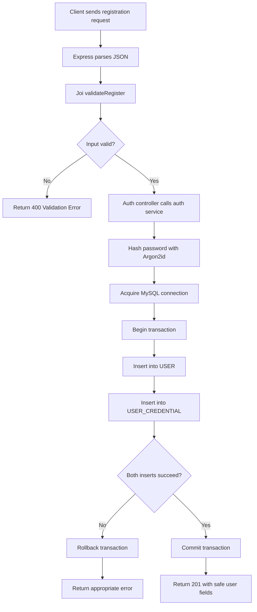
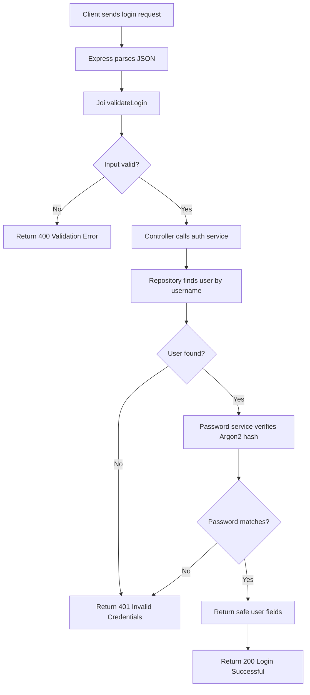
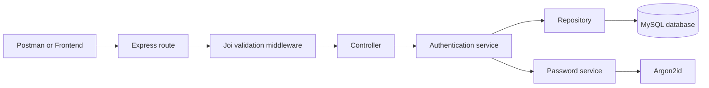

Mini Uber --- Backend and Database Progress
1. Project Overview
Mini Uber is a ride-sharing management system. The current backend work
focuses on user registration and login using Node.js, Express, MySQL,
Joi, and Argon2id.
Current technology stack
- Node.js --- JavaScript runtime
- Express.js --- HTTP server and API routing
- MySQL --- relational database
- mysql2 --- MySQL connection pool and queries
- Joi --- request validation
- Argon2id --- password hashing and verification
- Postman --- API testing
- MySQL Workbench --- database schema and query verification
Current scope: registration and credential verification at login are
implemented and have been tested. JWT access tokens, refresh-token
rotation, protected routes, and logout are planned but are not
implemented yet.

2. Project Structure
Project root:

D:\codes\Project\mini_uber\

Relevant files and folders:
mini_uber/
├── backend/
│   ├── config/
│   │   └── db.js
│   ├── controllers/
│   │   └── auth.controller.js
│   ├── repositories/
│   │   └── auth.repository.js
│   ├── routes/
│   │   └── auth.routes.js
│   ├── services/
│   │   ├── auth.service.js
│   │   └── password.service.js
│   ├── validators/
│   │   └── auth.validator.js
│   ├── .env
│   ├── package.json
│   └── server4.js
├── database/
│   └── schema.sql
├── docs/
└── frontend/
The folders frontend/ and docs/ are shown as project folders; this
README documents the backend and database work completed so far.
3. Database Design
Database: MINI_UBER

The schema contains 11 tables:
  Table                               Purpose
  USER                              Stores common profile information
                                      such as name, email, phone, and
                                      creation time

  USER_CREDENTIAL                   Stores a unique username and
                                      password hash for each user

  DRIVER                            Stores driver-specific information
                                      and availability status

  VEHICLE_TYPE                      Defines vehicle categories, such as
                                      bike, auto, or car

  VEHICLE                           Stores registered vehicles and
                                      their assigned drivers

  LOCATION                          Stores addresses and geographic
                                      coordinates

  RIDE                              Stores ride requests, locations,
                                      requested vehicle type, assigned
                                      vehicle, fare, times, and status

  PAYMENT                           Stores payment amount, method,
                                      status, transaction reference, and
                                      time

  RATING                            Stores a rating for a user in
                                      relation to a ride

  NOTIFICATION                      Stores messages and read/unread
                                      state for a user

  USER_SESSION                      Stores refresh-token hashes and
                                      session expiry/revocation
                                      information for planned session
                                  management
Important relationships
- USER_CREDENTIAL.user_id references USER.user_id.
- DRIVER.user_id references USER.user_id.
- VEHICLE.driver_user_id references DRIVER.user_id.
- VEHICLE.vehicle_type_id references VEHICLE_TYPE.vehicle_type_id.
- RIDE references the rider, optional assigned vehicle, requested
  vehicle type, pickup location, and drop-off location.
- PAYMENT.ride_id references RIDE.ride_id.
- RATING references a ride, the user who rated, and the user who was
  rated.
- NOTIFICATION.user_id and USER_SESSION.user_id reference
  USER.user_id.
Database safeguards
- Primary keys identify records.
- Unique constraints protect fields such as email, phone, username,
  registration number, and license number.
- Foreign keys maintain referential integrity.
- Check constraints validate values such as non-negative
  fares/payments, rating range, and geographic coordinates.
- Indexes support common lookups such as ride history, ride
  status/type, payments, notifications, and sessions.
Database verification completed
The database was created in MySQL Workbench. The 11 tables appeared,
foreign-key relationships and indexes were inspected, and a sample ride
was inserted and then rolled back in a transaction to test
relationships.
4. Registration API
Endpoint
POST http://localhost:4000/api/auth/register
Request body
{
  "name": "Test Rider",
  "email": "test.rider01@example.com",
  "phone": "9876500001",
  "username": "testrider01",
  "password": "Use-a-unique-test-password"
}
Use unique email, phone, and username values for each successful test.
Do not use a real or reused password in documentation or screenshots.
Registration flow
1. Express parses the JSON request body.
2. validateRegister validates the fields with Joi.
3. auth.controller.js calls registerUser() in the authentication
   service.
4. password.service.js hashes the password with Argon2id.
5. The service obtains a MySQL connection and begins a transaction.
6. The service inserts the profile into USER.
7. It inserts the username and password hash into USER_CREDENTIAL.
8. The transaction commits only if both inserts succeed. On failure, it
   rolls back.
9. The API returns 201 Created with safe user fields only.
Expected success response
{
  "success": true,
  "message": "User registered successfully.",
  "data": {
    "user": {
      "user_id": 2,
      "name": "Test Rider",
      "email": "test.rider01@example.com",
      "phone": "9876500001",
      "username": "testrider01"
    }
  }
}
The example user_id is illustrative; MySQL generates the actual ID.
Registration error handling
- 400 Bad Request --- Joi validation failed.
- 409 Conflict --- a unique field (email, phone, or username)
  already exists.
- 500 Internal Server Error --- unexpected registration failure.
The response should not include password hashes, raw SQL details, or
secrets.
5. Login API
Endpoint
POST http://localhost:4000/api/auth/login
Request body
{
  "username": "testrider01",
  "password": "The-same-test-password-used-at-registration"
}
Send the actual password used when creating the test account. Do not
store real passwords in this README.
Login flow
1. Express parses the JSON request body.
2. validateLogin validates the username and password with Joi.
3. auth.controller.js calls loginUser() in the authentication
   service.
4. auth.repository.js queries USER_CREDENTIAL and joins USER to
   retrieve the account and password hash.
5. If the username does not exist, the service returns null.
6. If the username exists, password.service.js verifies the submitted
   password against the stored Argon2id hash.
7. If the password is incorrect, the service returns null.
8. If credentials match, the service returns only safe user fields.
9. The controller responds with 200 OK.
Expected success response
{
  "success": true,
  "message": "Login successful.",
  "data": {
    "user": {
      "user_id": 2,
      "name": "Test Rider",
      "email": "test.rider01@example.com",
      "phone": "9876500001",
      "username": "testrider01"
    }
  }
}
Login error handling
- 400 Bad Request --- Joi validation failed.
- 401 Unauthorized --- username or password is incorrect.
- 500 Internal Server Error --- unexpected server-side error.
The username-not-found and wrong-password cases should return the same
public 401 response to avoid revealing whether an account exists.
Important: the current login implementation verifies credentials and
returns user information. It does not yet issue a JWT or establish
a token-based authenticated session. Add JWT authentication before
treating the login endpoint as complete for production use.

6. Flowcharts
Registration flow

Login flow

Request architecture

7. SOLID and Separation of Responsibilities
  Component                           Responsibility
  auth.routes.js                    Maps HTTP endpoints to middleware
                                      and controllers

  auth.validator.js                 Validates registration and login
                                      request bodies with Joi

  auth.controller.js                Converts service outcomes into HTTP
                                      responses

  auth.service.js                   Coordinates registration and login
                                      business workflows

  auth.repository.js                Performs authentication-related
                                      database queries

  password.service.js               Hashes and verifies passwords

  config/db.js                      Configures the MySQL connection
                                  pool
This structure supports the Single Responsibility Principle by
separating HTTP handling, validation, business workflows, database
access, and password operations. SRP does not require every function to
have its own file; each module should have a coherent responsibility.
8. Run and Test the Backend
Start the server
Open PowerShell in:

D:\codes\Project\mini_uber\backend

Run:
node server4.js
The server is configured to listen on port 4000.
Existing health checks
- GET http://localhost:4000/api/test
- GET http://localhost:4000/api/db-test
Test registration
Use Postman:
- Method: POST
- URL: http://localhost:4000/api/auth/register
- Header: Content-Type: application/json
- Body: raw JSON containing name, email, phone, username, and
  password
Test login
- Method: POST
- URL: http://localhost:4000/api/auth/login
- Header: Content-Type: application/json
- Body: raw JSON containing username and password
Useful SQL verification
USE MINI_UBER;

SELECT user_id, name, email, phone
FROM `USER`
ORDER BY user_id;

SELECT user_id, username, password_hash
FROM USER_CREDENTIAL
ORDER BY user_id;
Never display or return password_hash through the API. Inspect it only
when needed to confirm that it is a hash; do not expose it in
screenshots or shared logs.
9. Environment Configuration and Security
The backend reads database settings from backend/.env. The file should
contain values appropriate for your local MySQL installation:
DB_HOST=localhost
DB_USER=root
DB_PASSWORD=YOUR_LOCAL_MYSQL_PASSWORD
DB_NAME=MINI_UBER
DB_PORT=3306
- Replace the placeholder password locally; do not commit .env to
  Git.
- Keep .env.example as a template with placeholders only.
- Never commit database passwords, JWT secrets, real passwords, or
  tokens.
- Use HTTPS in deployed environments.
- Keep detailed internal errors in server logs, not in public API
  responses.
- Apply rate limiting to authentication endpoints before deployment.
10. Current Progress
Completed
- [x] Created the MINI_UBER database and 11 tables.
- [x] Verified table creation, foreign keys, constraints, and indexes.
- [x] Tested sample data and ride relationships using a transaction.
- [x] Configured the backend MySQL connection.
- [x] Added Joi registration and login validation.
- [x] Implemented registration with Argon2id password hashing.
- [x] Used a MySQL transaction to create both user and credential
  records atomically.
- [x] Added duplicate-registration handling.
- [x] Created an authentication repository for lookup by username.
- [x] Created a password service for hashing and verification.
- [x] Refactored the authentication service to use the repository and
  password service.
- [x] Added registration and login controllers and routes.
- [x] Successfully tested registration and successful login.
Next tasks
- [ ] Confirm wrong-password and unknown-username requests both return
  401.
- [ ] Remove or reduce temporary diagnostic logging after debugging.
- [ ] Implement JWT access-token generation and verification
  middleware.
- [ ] Implement refresh-token sessions using USER_SESSION, including
  rotation and revocation.
- [ ] Implement logout and protected-route authorization.
- [ ] Add automated tests for validation, duplicate accounts,
  transaction rollback, and login.
- [ ] Review production readiness, rate limiting, logging, and secret
  handling.
11. Important Notes
- MySQL AUTO_INCREMENT IDs may contain gaps. A missing ID does not
  mean a user currently exists.
- CREATE TABLE IF NOT EXISTS does not update the structure of a
  table that already exists.
- The current API is a learning implementation and is not
  production-ready until token authentication, session management,
  authorization, and additional security controls are implemented.